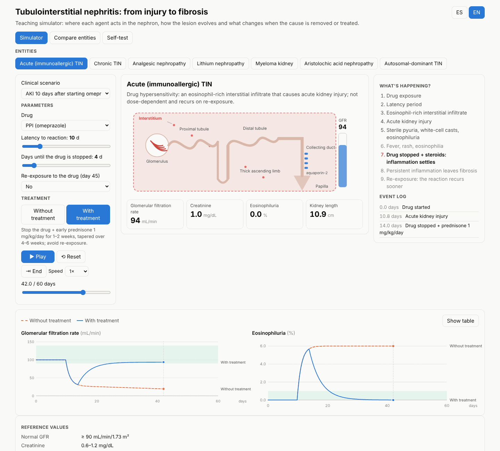

# Tubulointerstitial nephritis: from injury to fibrosis

**Nefropatías tubulointersticiales: de la agresión a la fibrosis** — interactive teaching simulator (Spanish / English).

**Live demo:** https://ferasmed-dev.github.io/tubulointerstitial-nephritis/ · English: https://ferasmed-dev.github.io/tubulointerstitial-nephritis/?lang=en



One nephron in its interstitium, with each agent placed where it acts — interstitium, proximal tubule, thick ascending limb, distal tubule, collecting duct and papilla. Students follow the lesion from injury to fibrosis and see what changes when the cause is removed or treated.

## What it shows

| Entity | Site | Time axis | Treatment arm |
|---|---|---|---|
| Acute (immunoallergic) TIN | interstitium | days | stop the drug + prednisone on a chosen day; optional re-exposure |
| Chronic TIN | interstitium | years | treat the cause from a chosen year |
| Analgesic nephropathy | papilla | years | stop analgesics |
| Lithium nephropathy | collecting duct | years | stop lithium |
| Myeloma kidney (cast nephropathy) | distal tubule | weeks | hydration + calcium correction + anti-myeloma therapy |
| Aristolochic acid nephropathy | proximal tubule | years | stop exposure (progression may continue) |
| Autosomal-dominant TIN (UMOD, MUC1, REN) | thick ascending limb | age (years) | none (no specific treatment) |

Every entity offers:

- a **schematic** that highlights where the lesion sits and grows with severity;
- **sliders and choices** for the parameters that drive it;
- a **sin / con tratamiento** (without / with treatment) comparison drawn on the same chart (dashed = without, solid = with);
- a **"¿Qué está pasando?"** panel that lights up each step of the mechanism as it happens, plus an **event log**;
- gauges with reference ranges, a **data-table view** of every chart, a **compare** tab with all entities side by side and a **self-test** tab.

## Curriculum fit

For students and teachers at any Spanish medical faculty.

- **Module (Orden ECI/332/2008):** Módulo III, *Formación clínica humana* (with support from Módulo II for physiology and pathology).
- **Typical subjects:** Fisiopatología, Patología médica / Nefrología, Anatomía patológica, Farmacología.
- **MIR:** core content of the Nefrología block.

## For teachers

Every scenario has a deep link you can project or share. Add `&lang=en` for English.

| Preset | Scenario (EN) | Expected result | Link |
|---|---|---|---|
| `ibp_10_dias` | AKI 10 days after starting omeprazole | GFR 100 → ~28 at day 15; stopped on day 14 → recovers to ~94 (untreated ~14) | [ES](https://ferasmed-dev.github.io/tubulointerstitial-nephritis/?preset=ibp_10_dias) · [EN](https://ferasmed-dev.github.io/tubulointerstitial-nephritis/?preset=ibp_10_dias&lang=en) |
| `betalactamico_tardio` | β-lactam stopped late (day 26) | fibrosis sets in: recovery only to ~80 | [ES](https://ferasmed-dev.github.io/tubulointerstitial-nephritis/?preset=betalactamico_tardio) · [EN](https://ferasmed-dev.github.io/tubulointerstitial-nephritis/?preset=betalactamico_tardio&lang=en) |
| `reexposicion` | Re-exposure to the same drug | recovers to ~93, then AKI returns after re-exposure on day 45 (GFR ~23) | [ES](https://ferasmed-dev.github.io/tubulointerstitial-nephritis/?preset=reexposicion) · [EN](https://ferasmed-dev.github.io/tubulointerstitial-nephritis/?preset=reexposicion&lang=en) |
| `ir_sin_hta` | Advanced renal failure with normal-low BP | acidosis (year 1) before CKD G3 (year 5.6); SBP stays < 115 | [ES](https://ferasmed-dev.github.io/tubulointerstitial-nephritis/?preset=ir_sin_hta) · [EN](https://ferasmed-dev.github.io/tubulointerstitial-nephritis/?preset=ir_sin_hta&lang=en) |
| `nti_cronica_obstructiva` | Chronic TIN from obstruction | GFR ~14 at 15 years untreated vs ~67 when the cause is treated at year 3 | [ES](https://ferasmed-dev.github.io/tubulointerstitial-nephritis/?preset=nti_cronica_obstructiva) · [EN](https://ferasmed-dev.github.io/tubulointerstitial-nephritis/?preset=nti_cronica_obstructiva&lang=en) |
| `abuso_analgesicos` | Woman with chronic pain combining analgesics | papillary necrosis at 2.5 years; stopping at year 6 keeps GFR ~45 (vs 5) | [ES](https://ferasmed-dev.github.io/tubulointerstitial-nephritis/?preset=abuso_analgesicos) · [EN](https://ferasmed-dev.github.io/tubulointerstitial-nephritis/?preset=abuso_analgesicos&lang=en) |
| `litio_bipolar` | Bipolar patient on lithium | urine output 1.5 → 5.2 L/day, osmolality ~170; stopping at year 8 → ~2.1 L/day | [ES](https://ferasmed-dev.github.io/tubulointerstitial-nephritis/?preset=litio_bipolar) · [EN](https://ferasmed-dev.github.io/tubulointerstitial-nephritis/?preset=litio_bipolar&lang=en) |
| `litio_niveles_altos` | Persistently high lithium levels | DI by year 2.4; GFR ~65 at 20 years if continued | [ES](https://ferasmed-dev.github.io/tubulointerstitial-nephritis/?preset=litio_niveles_altos) · [EN](https://ferasmed-dev.github.io/tubulointerstitial-nephritis/?preset=litio_niveles_altos&lang=en) |
| `mieloma_cilindros` | Myeloma with hypercalcaemia and dehydration | GFR 85 → 4 in ~5 weeks untreated; ~70 with treatment from week 1 | [ES](https://ferasmed-dev.github.io/tubulointerstitial-nephritis/?preset=mieloma_cilindros) · [EN](https://ferasmed-dev.github.io/tubulointerstitial-nephritis/?preset=mieloma_cilindros&lang=en) |
| `hierbas_adelgazar` | Slimming herbs | GFR still falls after exposure stops at 1 year (ESRD ~5 years) | [ES](https://ferasmed-dev.github.io/tubulointerstitial-nephritis/?preset=hierbas_adelgazar) · [EN](https://ferasmed-dev.github.io/tubulointerstitial-nephritis/?preset=hierbas_adelgazar&lang=en) |
| `balcanes` | Balkan nephropathy | slow loss: GFR ~84 after 10 years | [ES](https://ferasmed-dev.github.io/tubulointerstitial-nephritis/?preset=balcanes) · [EN](https://ferasmed-dev.github.io/tubulointerstitial-nephritis/?preset=balcanes&lang=en) |
| `familia_gota` | Family with dialysis, hyperuricaemia and gout | gout at ~20, CKD G3 at ~40, ESRD at ~63 | [ES](https://ferasmed-dev.github.io/tubulointerstitial-nephritis/?preset=familia_gota) · [EN](https://ferasmed-dev.github.io/tubulointerstitial-nephritis/?preset=familia_gota&lang=en) |
| `ntiad_muc1` | Familial TIN from MUC1 | CKD G3 at ~36, ESRD at ~55, little hyperuricaemia | [ES](https://ferasmed-dev.github.io/tubulointerstitial-nephritis/?preset=ntiad_muc1) · [EN](https://ferasmed-dev.github.io/tubulointerstitial-nephritis/?preset=ntiad_muc1&lang=en) |

You can also open a single entity with `?entity=<key>` (keys are listed in `src/model.js`).

## Model

- **Acute TIN:** inflammation `I` rises to 1 after the latency (τ 1.5 days) and decays when the drug is stopped (τ 4 days with steroids); fibrosis accumulates as `dF/dt = 0.01·I` per day (max 0.6). `GFR = 100·(1 − F)·(1 − 0.72·I)`; eosinophiluria = 6·I %; kidney length 11 + 1.6·I − 2·F cm.
- **Chronic TIN:** GFR falls 0.9·intensity mL/min/year (1/year once the cause is treated). Tubular acidosis and polyuria appear early (driven by time × intensity), anaemia by renal damage; BP rises (volume) or falls (salt-wasting).
- **Analgesics:** GFR loss = 0.8 + 0.9·dose·(1.6 if combined with aspirin) mL/min/year while exposed; papillary necrosis beyond 10 kg cumulative.
- **Lithium:** nephrogenic DI index `1 − e^(−cumulative/7)` (cumulative = level × years) drives urine output (1.5 → 5.5 L/day) and urine osmolality (650 → 130 mOsm/kg).
- **Myeloma:** tubular obstruction grows with light-chain load × dehydration × hypercalcaemia; treatment cuts light chains to 15 % (τ 1.5 weeks) and lets obstruction clear.
- **Aristolochic acid:** herbal exposure loses ~20 mL/min/year (16 after stopping); Balkan form 1.6 mL/min/year; no HTA; urothelial-risk index grows with dose.
- **AD-TIN:** GFR normal until 15, then falls 2.0 (UMOD), 2.4 (MUC1) or 1.7 (REN) mL/min/year; uric acid rises early with UMOD.

GFR is converted to creatinine with a steady-state approximation, `Cr ≈ 90 / GFR` (0.9 mg/dL at 100 mL/min). **Model** tag: constants marked "Model" in `src/model.js` are teaching assumptions tuned so each preset reproduces the textbook course; they are not fitted to patient data.

### Parameters

| Parameter | Range (default) | Basis |
|---|---|---|
| Drug latency (acute TIN) | 1–50 days (10) | 1 day to 2 months, mean 10 days |
| Days until the drug is stopped | 2–20 (5) | Model |
| Prednisone effect | τ 4 days | 1 mg/kg/day for 1–2 weeks (standard) |
| Injury intensity (chronic TIN) | 1–10 (6) | Model |
| Analgesic intake | 0.5–5 kg/year (3) | dose-dependent; 3–4 kg/year classic heavy use |
| Serum lithium | 0.4–1.5 mEq/L (0.9) | therapeutic ~0.6–1.0 mEq/L |
| Light chains / calcium | 0.5–10 g/24 h (5) / 9–15 mg/dL (12.5) | Model / normal Ca 8.5–10.5 |
| Exposure (aristolochic acid) | 1–36 months (12) | Model |

### Known simplifications

- No glomerular component (e.g. NSAID minimal-change disease, light-chain glomerulopathy) is modelled.
- Creatinine is a steady-state conversion.
- Steroids and drug withdrawal are merged into a single intervention.
- Risk indices (urothelial cancer) are relative, not absolute probabilities.

### Content beyond the core notes

- **Lithium mechanism:** the core notes say DI comes from "vasopressin activation"; the standard mechanism (used here) is aquaporin-2 down-regulation with **resistance** to ADH.
- **Myeloma treatment** (hydration, calcium correction, bortezomib-based therapy) is standard care; the core notes give no treatment for cast nephropathy.
- The classic "triad" of acute TIN is shown as fever + rash + eosinophilia with AKI (the notes list the four together as a "triad").

## Layout

```
index.html
src/model.js       pure model: entities, gauges, presets, simulate()
src/i18n.js        ES + EN strings (events are factories, so a language switch re-renders them)
src/ui.js          DOM, animation loop, explanations; exposes window.__sim for automated checks
src/schematic.js   SVG schematic of the anatomy, highlighted per entity
src/charts.js      dependency-free SVG line charts with hover tooltips and table view
src/styles.css     light/dark via prefers-color-scheme, responsive
tests/model.test.js
curriculum.json    topic metadata
```

## Run locally

```bash
python3 -m http.server 8000
# open http://localhost:8000/
```

No build step, no dependencies.

## Tests

```bash
npm test        # node --test (Node 18+)
```

The tests cover well-formed output for every entity at default and extreme parameters (finite, non-negative, valid steps), purity, i18n completeness in both languages, every preset, and the key mechanism of each entity (direction of each effect and the treatment comparison). GitHub Actions runs them on every push.

## Deploy (GitHub Pages)

Settings → Pages → *Deploy from a branch* → `main` / `(root)`. The site is served at https://ferasmed-dev.github.io/tubulointerstitial-nephritis/.

## References

- Praga M, González E. Acute interstitial nephritis. *Kidney Int* 2010;77:956–61.
- KDIGO 2015 Autosomal Dominant Tubulointerstitial Kidney Disease consensus report.
- IMWG recommendations for the management of myeloma-related renal impairment (2016).
- Grollman AP. Aristolochic acid nephropathy: harbinger of a global iatrogenic disease. *Environ Mol Mutagen* 2013.
- Harrison's Principles of Internal Medicine, 21st ed., Tubulointerstitial diseases of the kidney.
- Farreras-Rozman, *Medicina Interna*, 19ª ed., Nefrología.

---

Herramienta docente · no apta para uso clínico — Teaching tool · not for clinical use. MIT licence © 2026 Feras Elhissi.
